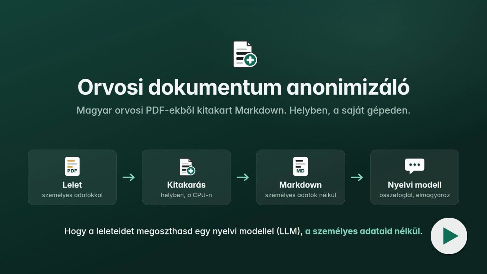
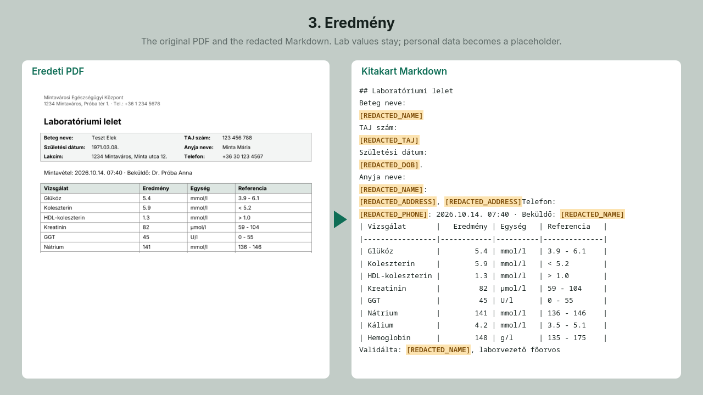
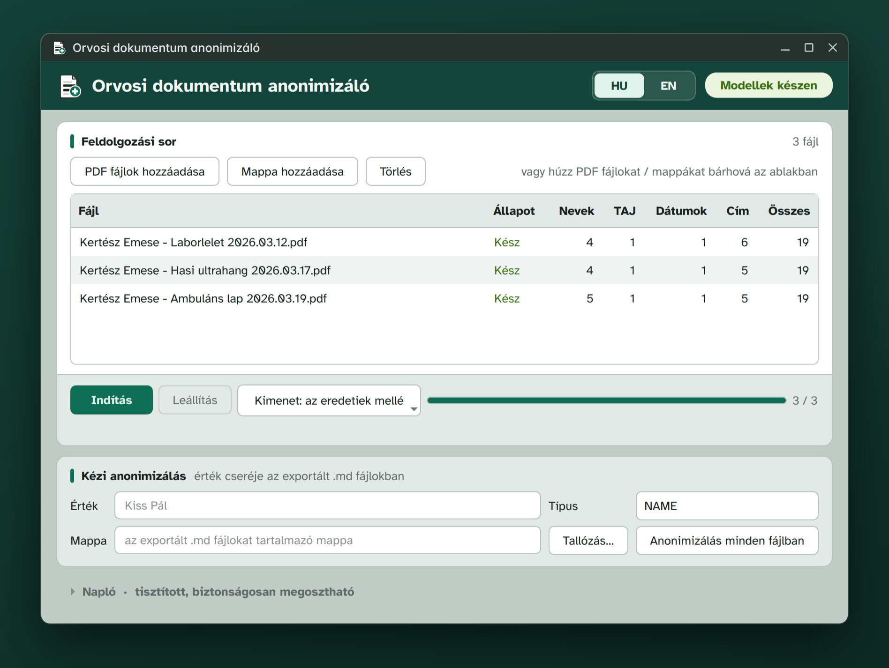

# Orvosi dokumentum anonimizáló

Asztali alkalmazás, ami magyar orvosi PDF-leletekből Markdown szöveget készít, a személyes adatok nélkül. Az így kapott szöveget odaadhatod egy nyelvi modellnek (LLM), hogy összefoglalja vagy elmagyarázza a leleteidet.

[](https://github.com/Tokra110/hungarian-medical-redactor/releases/download/v1.0.0/medical-redactor-demo.mp4)

*Bemutató videó, kb. 40 másodperc, hanggal. A videóban és a képeken minden név, szám és cím kitalált.*

## Miért készült?

Abból jött az egész, hogy a leleteimet be akartam adni egy nyelvi modellnek: foglalja össze, magyarázza el, lehessen kérdezgetni. Csak épp a személyes adataimat nem akartam feltölteni sehova. Ez a program ezért előbb helyben kitakarja a dokumentumot, és csak a már anonimizált szöveg megy tovább.

Minden a saját gépeden fut, CPU-n (ONNX Runtime, se PyTorch, se felhő). A dokumentumaid nem hagyják el a géped.

## Mit vesz ki, és mit hagy meg?

| Kiveszi | Megtartja |
|---|---|
| Nevek: beteg, hozzátartozó, orvos | Vizsgálati dátumok |
| TAJ-szám, születési dátum | Laborértékek, mértékegységek, referenciatartományok |
| Lakcím, telefonszám, e-mail | A táblázatok szerkezete |
| Orvosi pecsétszám, naplószám, más azonosítók | Leletek, vélemények, diagnózisok (BNO-kóddal) |
| Intézmények neve és címe | |
| Ugyanezeket a fájlnévből is | |

A kivett adat helyére típusjelölt helyőrző kerül, például `[REDACTED_NAME]` vagy `[REDACTED_TAJ]`, így látszik, mi volt ott.



## Az alkalmazás

PDF-eket vagy egész mappát húzhatsz be, az Indítás gomb pedig sorban feldolgozza őket. A táblázat fájlonként mutatja, hány nevet, TAJ-számot, dátumot és címet takart ki. Ha egy nevet a program nem talált meg, a Kézi anonimizálás résznél minden kész fájlban kicserélheted.



## Letöltés

A [legújabb kiadásnál](https://github.com/Tokra110/hungarian-medical-redactor/releases/latest):

- Windows: `*-setup.exe` (telepítő) vagy `*-windows-x86_64.zip` (telepítés nélkül)
- Linux: `*.rpm` (Fedora és társai) vagy `*-linux-x86_64.tar.gz`

Az első indításkor a program letölti a modelleket, ez kb. 655 MB.

## Hogyan működik?

1. A PDF-et a [Docling](https://github.com/docling-project/docling) alakítja Markdownná. A laboreredmény-táblázatok szerkezete megmarad.
2. Egy magyar HuBERT NER-modell megkeresi a neveket, helyeket, intézményeket.
3. Magyar szabályok keresik a TAJ-számot (ellenőrzőösszeggel), a telefonszámokat, címeket, születési dátumokat és a mezőcímkék melletti neveket.
4. Minden találat a helyőrzőjére cserélődik, a fájlnévben is.

> Csak EESZT-ből letöltött dokumentumokkal teszteltem: labor, ambuláns lap, képalkotó leletek. Más forrásból jövő PDF (magánklinika saját sablonja, papírról szkennelt lelet) működhet, de nincs validálva. Ilyenkor különösen alaposan nézd át az eredményt.

> A gépi kitakarás sosem tökéletes. Mielőtt bárhova továbbadod a kimenetet, olvasd át.

---

# Technical documentation (English)

Desktop app (PySide6) that turns Hungarian medical PDFs into Markdown with the personal data removed, so the text can go to an LLM for a summary or an explanation. PII detection runs in two layers: a Hungarian HuBERT NER model (ONNX) plus Hungarian-specific regexes. Inference is local, CPU-only, torch-free. The [demo video](https://github.com/Tokra110/hungarian-medical-redactor/releases/download/v1.0.0/medical-redactor-demo.mp4) shows a run on invented documents.

It removes names (patients, relatives, doctors), TAJ numbers, birth dates, addresses, phone numbers, e-mail addresses, doctor stamp numbers, record IDs and institution names, also from file names. It keeps examination dates, lab values with units and reference ranges, table structure, findings and diagnoses.

The app works and has tests, but treat it as a work in progress. The app downloads its HuBERT and TableFormer ONNX models from the public `models-v1` GitHub Release on first use. Validation so far covers EESZT documents only (see the Hungarian note above).

## Pipeline

1. PDF to markdown with Docling (slim, torch-free): ONNX layout analysis, an app-local ONNX port of the TableFormer table-structure model, RapidOCR for scanned pages. Lab tables come through with structure intact.
2. NER pass: the HuBERT token classifier finds persons, locations, organizations.
3. Regex pass: TAJ numbers (with checksum validation), phones, emails, addresses, birth dates. Exam dates are kept on purpose; only dates near birth-related keywords are redacted. Names are also caught next to ~30 Hungarian field labels ("beteg neve", "anyja neve", ...).
4. Redaction: matched spans become typed placeholders (`[REDACTED_NAME]`, `[REDACTED_TAJ]`, ...). Output filenames are redacted too.

## Running from source

Requires Python 3.13 (several ML dependencies don't support 3.14 yet).

```bash
bash setup.sh                 # creates .venv, installs torch-free runtime deps
.venv/bin/python main.py
```

Model artifacts (about 655 MB: HuBERT NER + TableFormer as ONNX) are not tracked in git. The in-app downloader fetches them from the public `models-v1` GitHub Release and verifies every file against the size and SHA-256 recorded in `models_manifest.json`.

You can also regenerate them locally with the export scripts. That needs a separate venv from `requirements-export.txt`, which pulls torch:

```bash
python scripts/export_hubert_onnx.py
python scripts/export_tableformer_onnx.py
```

## Release builds

`packaging/` holds the PyInstaller, RPM, and Inno Setup definitions. `.github/workflows/release.yml` builds Linux (tar.gz + rpm) and Windows artifacts on version tags. Windows users can choose the standard per-user installer (`*-setup.exe`) or a portable zip. The installer adds a Start menu shortcut, supports normal Windows uninstall, and optionally creates a desktop shortcut. Bundles ship without models; the in-app downloader fetches them on first run. On Windows, downloaded models and diagnostic logs live beside the installed executable under `models\` and `logs\`. During uninstall, the user is asked whether downloaded models should also be removed; removal is selected by default, while choosing No keeps them for a later reinstall. Diagnostic logs are retained. Versions installed before 0.1.4 automatically move existing models from the previous per-user data directory.

Before publishing, the Windows release gate installs the candidate, downloads and hashes the real HuBERT and TableFormer models, starts from an empty Docling cache, processes a vector PDF with a table and an image-only OCR PDF, checks the redacted contents and filenames, opens the real Qt window, then upgrades the newest published installer and repeats the verification while confirming that models and logs survived. The first app release had no earlier installer, so it skipped only that upgrade step. A manual workflow run performs the same Windows check without publishing anything.

## Model attribution

The app runs third-party models. The weights are not ours and keep their original licenses:

| Model | Source | License |
|---|---|---|
| Hungarian HuBERT NER | [NYTK/named-entity-recognition-nerkor-hubert-hungarian](https://huggingface.co/NYTK/named-entity-recognition-nerkor-hubert-hungarian) | Apache-2.0 |
| TableFormer (table structure) | [docling-project/docling-models](https://huggingface.co/docling-project/docling-models) (IBM Research) | Apache-2.0 / CDLA-Permissive-2.0 |
| PP-OCR models (via RapidOCR) | [PaddleOCR](https://github.com/PaddlePaddle/PaddleOCR) | Apache-2.0 |

The NER and TableFormer weights were converted to ONNX for torch-free CPU inference, otherwise unmodified. `medical_redactor_onnx/vendor/` contains cell-matching modules from [docling-ibm-models](https://github.com/docling-project/docling-ibm-models) (MIT) with import paths rewritten.

## License

[MIT](LICENSE) for the code in this repository. Model weights keep their upstream licenses, see above.
